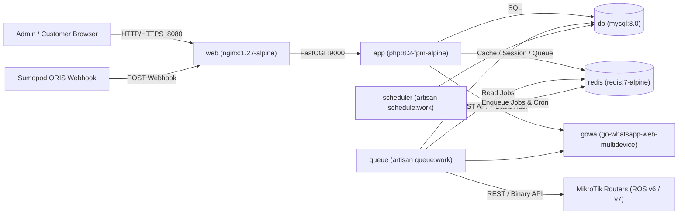

# IQ Bill

**Billing RT/RW Net & Management PPPOE Mikrotik REST API**

IQ Bill is an enterprise-ready ISP and RT/RW Net billing platform built on **Laravel 11**, **Livewire 3**, **Tailwind CSS**, **MySQL 8.0**, **Redis**, and **MikroTik RouterOS API (v6 & v7)**. It unifies automated recurring billing, QRIS instant payment settlement, one-way database-to-router PPPoE orchestration, automatic 23:59 WIB overdue isolation, self-service customer portal & PDF invoicing, and a pre-integrated **Go-WhatsApp (`aldinokemal/go-whatsapp-web-multidevice`)** notification stack.

---

## Key Features

### 1. Executive Billing & Revenue Analytics
- **Executive Dashboard:** Real-time Net & Gross paid revenue, unpaid/overdue invoice totals, active/isolated subscription metrics, active router count, and **Monthly Revenue** interactive bar charts (Net/Gross toggle, 6M/12M window).
- **Recent Invoices & Quick Shortcuts:** Instant copyable Smart Payment Links and role-aware shortcuts on the dashboard alongside a global **Quick Customer Search** (`Cmd/Ctrl+K` style FAB) across admin pages.
- **Role-Based Access Control (RBAC):** Distinct access boundaries for `SuperAdmin`, `Finance`, `NOC`, and `Customer`.

### 2. Multi-Router MikroTik Automation (RouterOS v6 & v7)
- **Dual-Protocol Driver:** Supports **RouterOS v7 REST API** and **RouterOS v6 Native Binary API** (`evilfreelancer/routeros-api-php`).
- **One-Way Source of Truth Sync:** Application database is canonical — `Sync DB -> MikroTik` aligns package PPPoE profiles and subscriber secrets directly on the router.
- **Multi-Router Package Assignment:** Each internet package can be mapped to one, multiple, or all MikroTik routers (`router_ids[]`) with dynamic filtering during customer onboarding and subscription editing.
- **Offline Router Resilience:** Failed or unreachable router actions (activate, restore, isolate, sync secret) are automatically queued (`mikrotik_pending_action`) and reconciled every 2 minutes by the scheduler (`mikrotik:reconcile-pending`).
- **Live PPPoE & Firewall Tools:** Inspect active PPPoE sessions, monitor real-time Rx/Tx traffic, manage PPPoE secrets/profiles, deploy isolation firewall rules, and track usage (`billing:sync-pppoe-usage`).

### 3. Automated Billing, Cash Renewals & Sumopod QRIS
- **Smart Payment Links:** Public tokenized checkout URLs (`/bayar/{token}`) with dynamic QRIS rendering, countdown expiry, and PII-masked public paid confirmation screens.
- **Sumopod Webhook Verification:** Supports Svix HMAC-SHA256 signature verification, `X-Webhook-Token`, or auto mode with full webhook audit logs.
- **Automated Lifecycle Schedules (`Asia/Jakarta` / WIB):**
  - `07:00 WIB` — Daily invoice generation & optional QRIS pre-generation (`billing:generate-invoices`).
  - `08:30 WIB` — H-3, due-day, and overdue WhatsApp payment reminders (`billing:send-reminders`).
  - `23:59 WIB` — Automatic overdue isolation on the subscriber's isolation day (`billing:isolate-overdue`).
- **Receive Cash Flow & Spreadsheet Onboarding:** One-click cash payment settlement (extends subscription by 1 month and restores MikroTik access) plus bulk `.xlsx` customer import/export.

### 4. Bundled Go-WhatsApp (GOWA) & Admin Telegram Bot
- **Zero-Touch Docker GOWA Integration:** Includes `aldinokemal2104/go-whatsapp-web-multidevice:latest` (`gowa`) in Docker Compose. On container startup, `php artisan gowa:sync-config` automatically seeds `http://gowa:3000` and Basic Auth credentials into IQ Bill without overwriting manual UI overrides.
- **WhatsApp Management UI:** Scan QR codes or request pairing codes directly inside **Admin -> Go-WhatsApp Device** (loopback/relative `qr_link` URLs returned by GOWA are rewritten seamlessly to the internal service origin).
- **Customer Message Templates & Bulk Broadcast:** Customizable WhatsApp reminder/isolation templates (Indonesian customer-facing defaults preserved out of the box) with live WhatsApp bubble previews, regex placeholders, and queued/synchronous bulk broadcast campaigns.
- **Admin Telegram Bot:** Real-time alerts for incoming QRIS/cash payments and deduplicated router/gateway error alerts.

### 5. Customer Self-Service Portal & Support Tickets
- **Customer Portal:** Connection overview, live service status, monthly Rx/Tx data usage in GB, active invoice callout, and QRIS online payment.
- **Official PDF & Print Invoices:** Built-in dependency-free Type1 PDF 1.4 invoice generator (`InvoicePdfService`) and clean printable A4 invoice view.
- **Support Ticketing:** Customers submit outage, installation, or billing tickets; technicians/NOC claim tickets, post internal notes, and update resolution status.

### 6. System Health & Automation Observability
- Live server CPU, RAM, and disk metrics via **System Monitoring** and `/api/health`.
- Heartbeat monitoring for both **Laravel Scheduler** (every 1 minute) and **Queue Worker** (auto-ping every 5 minutes plus on-demand `Test Queue Worker` ping) with dashboard attention banners if either stalls.

---

## Production Architecture (Docker Stack)



### Container Services in `docker-compose.yml`

| Service | Image / Target | Purpose |
| --- | --- | --- |
| `web` | Multi-stage `web` (`nginx:1.27-alpine`) | Serves static `/build/` Vite assets and proxies PHP requests to `app:9000` |
| `app` | Multi-stage `app` (`php:8.2-fpm-alpine`) | Runs migrations, initial seed (if `users` table is empty), `gowa:sync-config`, caches, and `php-fpm` |
| `queue` | Same `app` image (`CONTAINER_ROLE=queue`) | Runs `php artisan queue:work --sleep=3 --tries=3 --timeout=85 --max-time=3600 --backoff=10,30,60` |
| `scheduler` | Same `app` image (`CONTAINER_ROLE=scheduler`) | Runs `php artisan schedule:work` for billing, reminders, usage sync, MikroTik reconcile, & heartbeats |
| `db` | `mysql:8.0` | Primary relational database (`utf8mb4_unicode_ci`) persisted in `mysql_data` |
| `redis` | `redis:7-alpine` | Persistent (`--appendonly yes`) Redis store for sessions, caches, locks, and queues |
| `gowa` | `aldinokemal2104/go-whatsapp-web-multidevice:latest` | Bundled WhatsApp Web gateway persisted in `gowa_storages` & `gowa_statics` |

---

## Quick Production Deployment (Docker Compose)

### 1. Prerequisites
- Linux/Windows host with **Docker** and **Docker Compose v2** (`docker compose`)
- Domain/reverse proxy (e.g., Nginx Proxy Manager, Caddy, Traefik, or Cloudflare Tunnel) terminating TLS in front of port `8080`

### 2. Configure Production Environment
Copy `.env.production.example` to `.env`:

```bash
cp .env.production.example .env
```

Generate a strong Laravel `APP_KEY` (you can generate one with PHP, OpenSSL, or `php artisan key:generate --show`):

```bash
echo "base64:$(openssl rand -base64 32)"
```

Edit `.env` and set **mandatory production secrets** before first boot:

- `APP_KEY` — 32-byte base64 key generated above (**required**, entrypoint aborts if empty in production)
- `APP_URL` — Public HTTPS URL of your installation (e.g. `https://billing.your-isp.com`)
- `DB_PASSWORD` & `DB_ROOT_PASSWORD` — Strong MySQL passwords
- `REDIS_PASSWORD` — Strong Redis password
- `ADMIN_EMAIL` & `ADMIN_PASSWORD` — Initial Super Admin email and password (**minimum 12 characters required in production**)
- `GOWA_BASIC_AUTH_USER` & `GOWA_BASIC_AUTH_PASSWORD` — Shared Basic Auth credentials automatically configured on both the `gowa` container and IQ Bill

### 3. Build & Start Stack

```bash
docker compose up -d --build
```

Check container status and health:

```bash
docker compose ps
docker compose logs -f app queue scheduler gowa
```

On first launch, `iqbill_app` automatically:
1. Waits for MySQL (`db:3306`) and Redis (`redis:6379`).
2. Creates `storage:link` and executes `php artisan migrate --force`.
3. Seeds initial data (`AdminUserSeeder`, `CompanySettingSeeder`, `NotificationTemplateSeeder`) if no users exist yet (`AUTO_SEED=true`).
4. Runs `php artisan gowa:sync-config` so `http://gowa:3000` and Basic Auth credentials are pre-wired in `company_settings`.
5. Caches config, routes, and Blade views and starts `php-fpm`.
6. Once migrations complete, `iqbill_queue` and `iqbill_scheduler` start automatically.

### 4. Link WhatsApp via Bundled Go-WhatsApp (GOWA)
No manual container IP lookup is required:
1. Sign in to IQ Bill (`https://your-domain` or `http://localhost:8080`) using your `ADMIN_EMAIL` / `ADMIN_PASSWORD`.
2. Navigate to **WhatsApp -> Go-WhatsApp Device** (`/admin/whatsapp/device`).
3. Verify `GOWA Base URL` is pre-filled as `http://gowa:3000` with your `GOWA_BASIC_AUTH_USER`.
4. Click **Show Login QR** (or enter a phone number and click **Request Code** for Pairing Code login) and scan with **WhatsApp -> Linked Devices**.
5. Test delivery immediately using the **Send GOWA Test Message** card.

> **Security Note:** By default, `docker-compose.yml` binds GOWA's port to loopback only (`${GOWA_HOST_BIND:-127.0.0.1}:${GOWA_HOST_PORT:-3000}:3000`) so the Go-WhatsApp UI/API is never exposed directly to the public internet while `iqbill_app` and `iqbill_queue` still communicate internally over `http://gowa:3000`.

---

## Automated Scheduler & Queue Worker Operations

All scheduled tasks run on `Asia/Jakarta` (`WIB`) timezone in [`routes/console.php`](routes/console.php):

| Schedule | Artisan Command / Job | Purpose |
| --- | --- | --- |
| Every 1 minute | `system:scheduler-heartbeat` | Records live scheduler heartbeat for System Monitoring |
| Every 2 minutes | `mikrotik:reconcile-pending` | Retries pending MikroTik provisioning/restore/isolation syncs |
| Every 5 minutes | `billing:sync-pppoe-usage` | Polls PPPoE active traffic & monthly Rx/Tx usage |
| Every 5 minutes | `system:queue-heartbeat` | Pings queue worker when idle to confirm worker liveness |
| Daily `07:00 WIB` | `billing:generate-invoices` | Issues upcoming cycle invoices & optional QRIS pre-generation |
| Daily `08:30 WIB` | `billing:send-reminders` | Sends H-3, due-date, and overdue WhatsApp notifications |
| Daily `23:59 WIB` | `billing:isolate-overdue` | Automatically isolates overdue unpaid subscriptions on MikroTik |

Force re-sync GOWA environment settings into the database at any time:

```bash
docker compose exec app php artisan gowa:sync-config --force
```

Clear & rebuild cached Laravel configuration after editing `.env` on the host:

```bash
docker compose up -d --force-recreate app queue scheduler
```

---

## Manual VPS Deployment (Without Docker)

### System Requirements
- **PHP 8.2+** with extensions: `bcmath`, `gd`, `intl`, `mbstring`, `opcache`, `pcntl`, `pdo_mysql`, `sockets`, `zip`
- **Composer 2.x** & **Node.js 20+**
- **MySQL 8.0** (or MariaDB 10.6+) & **Redis 7**
- **Nginx** + **Supervisor**

### Installation Steps
```bash
git clone <your-repository-url> iqbill
cd iqbill
composer install --no-dev --optimize-autoloader
npm ci && npm run build
cp .env.example .env
php artisan key:generate
```

Update `.env` for local MySQL (`DB_HOST=127.0.0.1`), Redis (`REDIS_HOST=127.0.0.1`), `APP_ENV=production`, `APP_DEBUG=false`, `ADMIN_PASSWORD` (12+ chars), and your external `GOWA_API_URL`, then initialize:

```bash
php artisan storage:link
php artisan migrate --force
php artisan db:seed --force
php artisan gowa:sync-config
php artisan optimize
```

### Supervisor Configuration (`/etc/supervisor/conf.d/iqbill.conf`)
```ini
[program:iqbill-queue]
process_name=%(program_name)s_%(process_num)02d
command=php /var/www/iqbill/artisan queue:work --sleep=3 --tries=3 --timeout=85 --max-time=3600 --backoff=10,30,60 --no-interaction
autostart=true
autorestart=true
stopasgroup=true
killasgroup=true
user=www-data
numprocs=1
redirect_stderr=true
stdout_logfile=/var/www/iqbill/storage/logs/queue-worker.log
stopwaitsecs=3600

[program:iqbill-scheduler]
command=php /var/www/iqbill/artisan schedule:work --no-interaction
autostart=true
autorestart=true
stopasgroup=true
killasgroup=true
user=www-data
redirect_stderr=true
stdout_logfile=/var/www/iqbill/storage/logs/scheduler.log
```

*(Or use standard Linux cron `* * * * * cd /var/www/iqbill && php artisan schedule:run >> /dev/null 2>&1` instead of `schedule:work`.)*

---

## Key Environment Variables Reference

| Variable | Default / Example | Description |
| --- | --- | --- |
| `APP_NAME` / `APP_TAGLINE` | `IQ Bill` | Brand name and login/header subtitle |
| `APP_URL` / `APP_PORT` | `https://billing.example.com` / `8080` | Public URL and host HTTP port mapped to Nginx |
| `APP_TIMEZONE` | `Asia/Jakarta` | Billing schedule & invoice timestamp timezone (WIB) |
| `TRUSTED_PROXIES` | `*` | Reverse proxy trust setting for HTTPS detection behind TLS proxies |
| `SESSION_SECURE_COOKIE` | `true` (prod) / `false` (HTTP) | Set `false` temporarily only when testing over plain HTTP (`http://localhost`) |
| `DB_*` | `mysql`, `db`, `3306`, `iqbill` | Database driver & credentials (`AUTO_MIGRATE`, `AUTO_SEED` control entrypoint bootstrap) |
| `QUEUE_CONNECTION` / `CACHE_STORE` | `redis` | Powered by `predis/predis` against `REDIS_HOST=redis` |
| `ADMIN_EMAIL` / `ADMIN_PASSWORD` | `admin@iqbill.local` | Initial Super Admin account seeded on blank databases (12+ chars enforced in production) |
| `GOWA_API_URL` | `http://gowa:3000` | Internal/external Go-WhatsApp endpoint synced by `gowa:sync-config` |
| `GOWA_BASIC_AUTH_USER` / `_PASSWORD` | `iqbill` | Shared Basic Auth user & password (`APP_BASIC_AUTH`) |
| `GOWA_HOST_BIND` / `GOWA_HOST_PORT` | `127.0.0.1` / `3000` | Host binding for direct GOWA access |
| `GOWA_AUTO_SYNC` / `GOWA_FORCE_SYNC` | `true` / `false` | Syncs env GOWA settings into `company_settings` if unset (or forces overwrite) |

---

## External Integrations Setup

1. **MikroTik RouterOS Preparation:**
   - **RouterOS v7:** Enable `/ip/service/set www-ssl disabled=no` (or `www` for local VPN tunnels) and create a dedicated API user group with REST API write access. Add your routers under **MikroTik -> Routers** and click **Setup Firewall** + **Sync DB -> MikroTik**.
   - **RouterOS v6:** Enable `api` (`8728`) or `api-ssl` (`8729`) under `/ip/service`.
2. **Sumopod Managed Payment:**
   - Copy the **Sumopod Webhook Endpoint URL** shown inside **Admin -> Settings -> Payment & Integrations**.
   - Configure your `X-Api-Key`, `Svix Signing Secret (whsec_...)`, and/or `Webhook Token (whtok_...)`.

---

## Security & Backup Recommendations

- Never commit `.env` files to version control; rotate `ADMIN_PASSWORD`, `DB_PASSWORD`, `REDIS_PASSWORD`, and `GOWA_BASIC_AUTH_PASSWORD` before going live.
- Terminate HTTPS in front of `web` using a reverse proxy and keep `APP_DEBUG=false` in production.
- Leave `GOWA_HOST_BIND=127.0.0.1` so the Go-WhatsApp container is only reachable from localhost/Docker internal network (`iqbill_net`).
- Back up Docker persistent volumes regularly (`mysql_data`, `app_storage`, `gowa_storages`):
  ```bash
  docker compose exec -T db mysqldump -u"$DB_USERNAME" -p"$DB_PASSWORD" "$DB_DATABASE" > backup-$(date +%F).sql
  ```

---

## Local Development & Test Suite

Install dependencies and build assets:

```bash
composer install
npm install && npm run build
cp .env.example .env
php artisan key:generate
touch database/database.sqlite
php artisan migrate --seed
```

Default seeded Super Admin credentials in **local/dev** (`AdminUserSeeder`):
- Email: `admin@iqbill.local`
- Password: `password` *(change immediately in staging/production)*

Run the automated Pest test suite (`RefreshDatabase` on SQLite):

```bash
php artisan test
```
