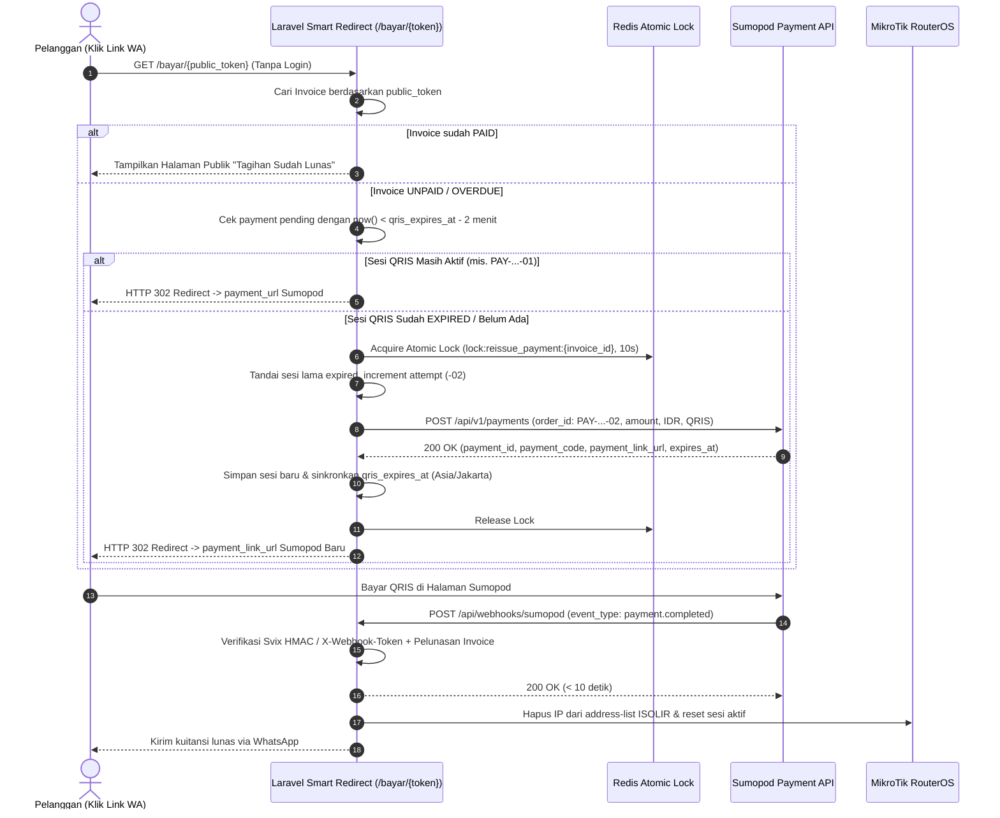

# Alur Bisnis, Billing Cycle & Provisioning MikroTik (`BUSINESS-FLOWS.md`)

Dokumen ini menjabarkan alur bisnis *end-to-end* mulai dari aktivasi pelanggan, penerbitan tagihan tunggal per siklus, alur **Smart Payment Link tanpa login (`/bayar/{public_token}`)**, pembayaran melalui **Customer Portal**, penanganan kedaluwarsa `order_id` Sumopod, hingga isolir dan pemulihan otomatis pada router **MikroTik**.

---

## 1. Alur Aktivasi Pelanggan Baru

1. Admin/NOC mendaftarkan profil pelanggan pada `customers` dan membuat kontrak layanan pada `subscriptions` (`status = 'pending_installation'`).
2. Setelah teknisi menyelesaikan instalasi fisik ONT di lokasi, NOC menekan tombol **Aktivasi Layanan**:
   * Sistem mengirim perintah API RouterOS (`MikrotikProvisioningJob`) untuk membuat `/ppp secret` (atau `/ip hotspot user`) sesuai `mikrotik_profile_name` paket.
   * Status `subscriptions.status` berubah menjadi `active`, `activated_at = now()`, dan `next_billing_date` ditetapkan.
   * Invoice siklus pertama diterbitkan (`INV-YYYYMM-XXXXXX`) beserta `public_token` acak $32$ karakter, dan tautan bayar cepat dikirim via WhatsApp.

---

## 2. Siklus Penagihan & Tautan WhatsApp Abadi (`H-7`, `H-3`, `H-1`)

Scheduler harian berjalan setiap pukul `07:00 WIB` (`Asia/Jakarta`):

1. **Penerbitan Invoice (`H-7` sebelum `next_billing_date`):**
   * Membuat **1 record invoice** pada `invoices` (`status = 'unpaid'`, `public_token = Str::random(32)`).
   * Jika `company_settings.pregenerate_qris_on_invoice = true`, sistem memanggil API Sumopod untuk membuat sesi pembayaran pertama (`PAY-202611-000123-01`).
   * Mengirim pesan WhatsApp `invoice_created` yang menyertakan **Smart Payment Link** `https://<domain-isp>/bayar/{public_token}` (bukan URL mentah Sumopod yang mati dalam $24$ jam).
2. **Pengingat Berjenjang (`H-3` dan `H-1` sebelum `due_date`):**
   * Mengirim pengingat WhatsApp (`reminder_h3`, `reminder_h1`) dengan tautan yang sama (`https://<domain-isp>/bayar/{public_token}`). Kapan pun pelanggan mengkliknya—meskipun sesi QRIS `-01` telah kedaluwarsa—sistem akan otomatis menyiapkan sesi baru (`-02`, `-03`) dan langsung mengarahkannya ke halaman bayar Sumopod.

---

## 3. Alur Smart Payment Link Tanpa Login (`GET /bayar/{public_token}`)

Alur ini memungkinkan pelanggan menyelesaikan pembayaran dengan **1 kali ketukan dari WhatsApp tanpa perlu login ke Customer Portal**, sekaligus mengatasi aturan Sumopod yang melarang penggunaan ulang `order_id` setelah `expires_at` ($24$ jam) habis.

### Rincian Aturan Teknis Smart Payment Link:
1. **Penyelesaian Batasan `order_id` Sumopod:**
   * Nomor invoice (`INV-202611-000123`) tetap satu untuk seluruh siklus tagihan.
   * Setiap kali sesi QRIS baru dibuat, `invoices.payment_attempt_count` bertambah $+1$ dan menghasilkan `payments.payment_code` baru (`PAY-202611-000123-01`, `PAY-202611-000123-02`, dst.) yang dikirim sebagai `order_id` ke Sumopod.
2. **Buffer Kedaluwarsa $2$ Menit:**
   * Jika sisa waktu `qris_expires_at` kurang dari $2$ menit, sistem menganggap sesi tersebut hampir kedaluwarsa dan langsung menerbitkan sesi baru agar QRIS tidak habis masa berlakunya tepat saat pelanggan membuka aplikasi e-wallet/mobile banking.
3. **Proteksi Klik Ganda (*Redis Atomic Lock*):**
   * Menggunakan `Cache::lock("reissue_payment:{$invoice->id}", 10)` sehingga jika pelanggan mengetuk tautan WhatsApp dua kali berturut-turut dalam $1$ detik, request kedua menunggu request pertama selesai dan menggunakan `payment_link_url` yang sama tanpa membuat dua transaksi di Sumopod.

---

## 4. Alur Pembayaran di dalam Customer Portal

Pelanggan yang memilih masuk ke **Customer Portal** tetap terhubung ke mesin pembayaran yang sama (`SumopodPaymentSessionService`):
1. Pada halaman **Dashboard** maupun **Detail Invoice**, pelanggan melihat status tagihan dan tombol **"Bayar Sekarang via Sumopod"**.
2. Saat halaman detail tagihan dibuka:
   * Sistem memanggil `SumopodPaymentSessionService::getOrCreateActiveSession($invoice)`.
   * Menampilkan **gambar kode QRIS** (dirender dari `payments.qris_string`), hitung mundur waktu kedaluwarsa berdasarkan `payments.qris_expires_at` dari Sumopod, serta tombol utama **"Buka Halaman Pembayaran Sumopod"** yang membuka `payments.payment_url`.
   * Browser melakukan pengecekan status ke endpoint lokal `GET /portal/invoices/{invoice}/status` setiap $4$ detik (tanpa memanggil API Sumopod). Begitu webhook Sumopod diterima backend, layar portal otomatis berubah menjadi kuitansi lunas.
   * Jika hitung mundur habis saat pelanggan masih membuka halaman portal, pelanggan cukup menekan tombol **"Perbarui Kode QRIS"** untuk membuat sesi `PAY-...-02` baru secara instan.

---

## 5. Pemrosesan Webhook Sumopod & Penanganan *Late Webhook*

Endpoint `POST /api/webhooks/sumopod` memproses notifikasi *push* dari Sumopod:

### 5.1. Event `payment.completed`
1. Validasi header autentikasi (`svix-id`/`svix-timestamp`/`svix-signature` atau `X-Webhook-Token`) menggunakan **raw HTTP body**.
2. Cek keunikan `svix-id` pada `payment_webhook_logs`. Jika sudah ada, kembalikan `200 OK` (`duplicate_ignored`).
3. Buka `DB::transaction()` dengan `lockForUpdate()` pada `payments` (dicari berdasarkan `external_reference = data.payment_id` atau `payment_code = data.order_id`) dan `invoices` induknya.
4. Perbarui sesi `payment` yang dibayar:
   * `status = 'paid'`, `gateway_fee = data.fee`, `net_amount = data.net_amount`, `paid_at`, `settled_at`.
5. **Penanganan *Late Webhook* (Race Condition):**
   * Apabila pelanggan memindai QRIS sesi `-01` pada detik-detik terakhir tepat setelah pelanggan lain/klik baru menerbitkan sesi `-02`, webhook `payment.completed` untuk sesi `-01` tetap **wajib diterima dan dilunasi**.
   * Sistem menandai sesi `-01` dan `invoices` induk menjadi `paid`, mencatat `processing_status = 'late_settled'` pada `payment_webhook_logs`, serta menandai seluruh sesi lain pada `invoice_id` tersebut yang masih `pending` (misalnya `-02`) menjadi `cancelled`.
6. Perbarui `invoices.status = 'paid'`, `invoices.paid_at = now()`.
7. **Pemulihan Layanan MikroTik & Kuitansi:**
   * Jika `subscriptions.status` adalah `isolated` atau `pending_installation`, ubah menjadi `active`, kosongkan `isolated_at`, dan dispatch `MikrotikProvisioningJob(action: 'restore')`.
   * Majukan `subscriptions.next_billing_date` $+1$ bulan dan kirim kuitansi WhatsApp `payment_receipt`.

### 5.2. Event `payment.failed` & `payment.expired`
* Mengubah status sesi `payments` terkait dari `pending` menjadi `failed` atau `expired`. Status `invoices` tetap `unpaid` (atau `overdue`) agar klik berikutnya pada Smart Payment Link `/bayar/{public_token}` atau Customer Portal otomatis menerbitkan sesi baru.

---

## 6. Alur Auto-Isolir Keterlambatan Pembayaran

Scheduler isolir berjalan setiap pukul `01:00 WIB`:
1. Cari seluruh `subscriptions` berstatus `active` yang memiliki invoice `unpaid`/`overdue` di mana `CURRENT_DATE > DATE_ADD(due_date, INTERVAL company_settings.grace_period_days DAY)`.
2. Ubah `invoices.status` menjadi `overdue` dan `subscriptions.status = 'isolated'`, `subscriptions.isolated_at = now()`.
3. Dispatch `MikrotikProvisioningJob(action: 'isolate')` untuk menambahkan IP pelanggan ke `/ip firewall address-list` `ISOLIR` dan memutus sesi aktif PPPoE/Hotspot.
4. Kirim pesan WhatsApp `service_isolated` yang memuat Smart Payment Link `https://<domain-isp>/bayar/{public_token}` agar pelanggan dapat langsung membayar tanpa login dan internetnya kembali aktif dalam hitungan detik.