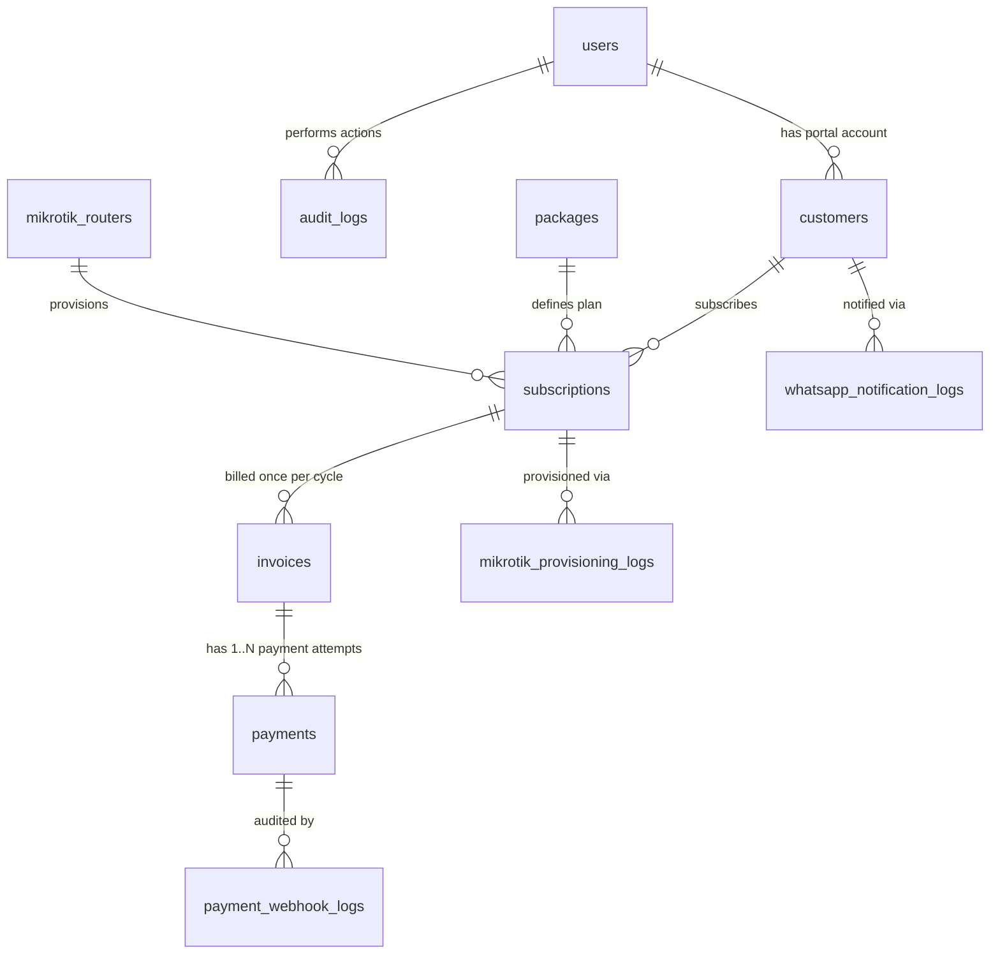

# Skema Database & Relasi Tabel (`DATABASE.md`)

Dokumen ini mendefinisikan struktur skema database relasional (**MySQL 8.0+ / MariaDB 10.6+**) untuk sistem **ISP Billing, MikroTik Provisioning & Sumopod Dynamic QRIS Portal**. Seluruh tabel menggunakan engine `InnoDB`, charset `utf8mb4`, collation `utf8mb4_unicode_ci`, dan zona waktu aplikasi `Asia/Jakarta` (`UTC+7`).

---

## 1. Diagram Relasi Entitas (ERD)

---

## 2. Spesifikasi Tabel Inti

### 2.1. `users`
Menyimpan akun autentikasi staf internal (`super_admin`, `finance`, `noc`) dan akun login Customer Portal (`customer`).

| Kolom | Tipe Data | Constraint | Keterangan |
| :--- | :--- | :--- | :--- |
| `id` | `BIGINT UNSIGNED` | `PK, AUTO_INCREMENT` | Primary key |
| `name` | `VARCHAR(120)` | `NOT NULL` | Nama lengkap pengguna |
| `email` | `VARCHAR(150)` | `UNIQUE, NOT NULL` | Email login |
| `phone` | `VARCHAR(25)` | `UNIQUE, NULL` | Nomor WhatsApp format `628xxx` |
| `password` | `VARCHAR(255)` | `NOT NULL` | Hash Bcrypt/Argon2id |
| `role` | `ENUM('super_admin','finance','noc','customer')` | `NOT NULL, DEFAULT 'customer'` | Peran RBAC |
| `is_active` | `BOOLEAN` | `NOT NULL, DEFAULT TRUE` | Status aktif akun |
| `last_login_at` | `TIMESTAMP` | `NULL` | Waktu login terakhir |
| `created_at` | `TIMESTAMP` | `NULL` | Waktu dibuat |
| `updated_at` | `TIMESTAMP` | `NULL` | Waktu diperbarui |

---

### 2.2. `company_settings`
Konfigurasi singleton untuk profil ISP, aturan penagihan, kredensial **Sumopod Managed Payment**, dan gateway WhatsApp.

| Kolom | Tipe Data | Constraint | Keterangan |
| :--- | :--- | :--- | :--- |
| `id` | `BIGINT UNSIGNED` | `PK, AUTO_INCREMENT` | Primary key (`id = 1`) |
| `company_name` | `VARCHAR(150)` | `NOT NULL` | Nama badan usaha ISP |
| `company_address` | `TEXT` | `NULL` | Alamat kantor operasional |
| `company_phone` | `VARCHAR(30)` | `NULL` | Nomor kontak CS / NOC |
| `invoice_prefix` | `VARCHAR(15)` | `NOT NULL, DEFAULT 'INV'` | Awalan nomor invoice (`INV`) |
| `payment_prefix` | `VARCHAR(15)` | `NOT NULL, DEFAULT 'PAY'` | Awalan kode sesi pembayaran Sumopod (`PAY`) |
| `default_due_days` | `TINYINT UNSIGNED` | `NOT NULL, DEFAULT 7` | Jarak hari jatuh tempo dari terbit invoice |
| `grace_period_days` | `TINYINT UNSIGNED` | `NOT NULL, DEFAULT 3` | Masa tenggang sebelum isolir otomatis |
| `pregenerate_qris_on_invoice` | `BOOLEAN` | `NOT NULL, DEFAULT TRUE` | Buat sesi QRIS pertama (`-01`) saat invoice terbit |
| `sumopod_environment` | `ENUM('sandbox','live')` | `NOT NULL, DEFAULT 'sandbox'` | Mode endpoint Sumopod (`api-pay-sandbox` vs `api-pay`) |
| `sumopod_api_key_encrypted` | `TEXT` | `NULL` | Header `X-Api-Key` terenkripsi |
| `sumopod_webhook_verification_mode` | `ENUM('signature','token','auto')` | `NOT NULL, DEFAULT 'auto'` | Mode verifikasi webhook (`svix` signature, `X-Webhook-Token`, atau otomatis) |
| `sumopod_signing_secret_encrypted` | `TEXT` | `NULL` | Svix Signing Secret (`whsec_...`) terenkripsi |
| `sumopod_webhook_token_encrypted` | `TEXT` | `NULL` | Static Webhook Token (`whtok_...`) terenkripsi |
| `sumopod_fee_bearer` | `ENUM('merchant','customer')` | `NOT NULL, DEFAULT 'merchant'` | Penanggung biaya QRIS ($0.7\% + \text{Rp } 300$) |
| `wa_gateway_url` | `VARCHAR(255)` | `NULL` | Endpoint REST WhatsApp Gateway |
| `wa_api_token_encrypted` | `TEXT` | `NULL` | Token autentikasi WhatsApp Gateway terenkripsi |
| `created_at` | `TIMESTAMP` | `NULL` | Waktu dibuat |
| `updated_at` | `TIMESTAMP` | `NULL` | Waktu diperbarui |

---

### 2.3. `mikrotik_routers`
Daftar perangkat NAS MikroTik RouterOS yang dikelola untuk provisioning PPPoE/Hotspot dan isolir otomatis.

| Kolom | Tipe Data | Constraint | Keterangan |
| :--- | :--- | :--- | :--- |
| `id` | `BIGINT UNSIGNED` | `PK, AUTO_INCREMENT` | Primary key |
| `name` | `VARCHAR(100)` | `NOT NULL` | Label router (mis. `NAS-CORE-01`) |
| `host` | `VARCHAR(120)` | `NOT NULL` | IP Public / VPN Tunnel / DDNS |
| `api_port` | `SMALLINT UNSIGNED` | `NOT NULL, DEFAULT 8728` | Port RouterOS API (`8728` / `8729` SSL) |
| `use_ssl` | `BOOLEAN` | `NOT NULL, DEFAULT FALSE` | Aktifkan koneksi API-SSL |
| `username` | `VARCHAR(80)` | `NOT NULL` | Username API RouterOS khusus billing |
| `password_encrypted` | `TEXT` | `NOT NULL` | Password API RouterOS terenkripsi |
| `isolir_address_list` | `VARCHAR(80)` | `NOT NULL, DEFAULT 'ISOLIR'` | Nama firewall address-list untuk pelanggan terisolir |
| `isolir_profile_name` | `VARCHAR(80)` | `NULL` | Profil PPPoE isolir opsional |
| `is_active` | `BOOLEAN` | `NOT NULL, DEFAULT TRUE` | Status router aktif |
| `last_health_check_at` | `TIMESTAMP` | `NULL` | Waktu pengecekan koneksi terakhir |
| `created_at` | `TIMESTAMP` | `NULL` | Waktu dibuat |
| `updated_at` | `TIMESTAMP` | `NULL` | Waktu diperbarui |

---

### 2.4. `packages`
Katalog paket layanan internet beserta pemetaan profil bandwidth pada MikroTik.

| Kolom | Tipe Data | Constraint | Keterangan |
| :--- | :--- | :--- | :--- |
| `id` | `BIGINT UNSIGNED` | `PK, AUTO_INCREMENT` | Primary key |
| `code` | `VARCHAR(30)` | `UNIQUE, NOT NULL` | Kode paket (mis. `HOME-30M`) |
| `name` | `VARCHAR(100)` | `NOT NULL` | Nama paket komersial |
| `service_type` | `ENUM('pppoe','hotspot')` | `NOT NULL, DEFAULT 'pppoe'` | Jenis autentikasi jaringan |
| `mikrotik_profile_name` | `VARCHAR(80)` | `NOT NULL` | Nama PPP/Hotspot Profile di MikroTik |
| `speed_download_mbps` | `SMALLINT UNSIGNED` | `NOT NULL` | Kecepatan unduh (Mbps) |
| `speed_upload_mbps` | `SMALLINT UNSIGNED` | `NOT NULL` | Kecepatan unggah (Mbps) |
| `price` | `DECIMAL(12,2)` | `NOT NULL` | Harga dasar bulanan (IDR) |
| `tax_rate` | `DECIMAL(5,2)` | `NOT NULL, DEFAULT 0.00` | Persentase PPN (mis. `11.00`) |
| `is_active` | `BOOLEAN` | `NOT NULL, DEFAULT TRUE` | Status paket tersedia |
| `created_at` | `TIMESTAMP` | `NULL` | Waktu dibuat |
| `updated_at` | `TIMESTAMP` | `NULL` | Waktu diperbarui |

---

### 2.5. `customers`
Data identitas pelanggan fisik maupun korporat.

| Kolom | Tipe Data | Constraint | Keterangan |
| :--- | :--- | :--- | :--- |
| `id` | `BIGINT UNSIGNED` | `PK, AUTO_INCREMENT` | Primary key |
| `user_id` | `BIGINT UNSIGNED` | `FK -> users.id, NULL` | Akun portal pelanggan |
| `customer_code` | `VARCHAR(30)` | `UNIQUE, NOT NULL` | ID Pelanggan (mis. `CUST-20260001`) |
| `full_name` | `VARCHAR(150)` | `NOT NULL` | Nama pelanggan |
| `nik_npwp` | `VARCHAR(30)` | `NULL` | Nomor identitas / NPWP |
| `phone_whatsapp` | `VARCHAR(25)` | `NOT NULL, INDEX` | Nomor WhatsApp tujuan tagihan (`628xxx`) |
| `email` | `VARCHAR(150)` | `NULL` | Email pelanggan |
| `installation_address` | `TEXT` | `NOT NULL` | Alamat pemasangan ODP/ONT |
| `latitude` | `DECIMAL(10,7)` | `NULL` | Koordinat GPS pelanggan |
| `longitude` | `DECIMAL(10,7)` | `NULL` | Koordinat GPS pelanggan |
| `created_at` | `TIMESTAMP` | `NULL` | Waktu dibuat |
| `updated_at` | `TIMESTAMP` | `NULL` | Waktu diperbarui |

---

### 2.6. `subscriptions`
Kontrak layanan aktif per titik sambungan pelanggan yang terikat pada satu router MikroTik dan satu paket.

| Kolom | Tipe Data | Constraint | Keterangan |
| :--- | :--- | :--- | :--- |
| `id` | `BIGINT UNSIGNED` | `PK, AUTO_INCREMENT` | Primary key |
| `customer_id` | `BIGINT UNSIGNED` | `FK -> customers.id, NOT NULL` | Pemilik langganan |
| `package_id` | `BIGINT UNSIGNED` | `FK -> packages.id, NOT NULL` | Paket layanan |
| `mikrotik_router_id` | `BIGINT UNSIGNED` | `FK -> mikrotik_routers.id, NOT NULL` | Router NAS tempat autentikasi |
| `service_username` | `VARCHAR(80)` | `UNIQUE, NOT NULL` | Username PPPoE / Hotspot |
| `service_password_encrypted` | `TEXT` | `NOT NULL` | Password PPPoE / Hotspot terenkripsi |
| `static_ip_address` | `VARCHAR(45)` | `NULL` | IP statis pelanggan (digunakan pada address-list isolir) |
| `billing_day` | `TINYINT UNSIGNED` | `NOT NULL, DEFAULT 1` | Tanggal siklus tagihan bulanan ($1 \le d \le 28$) |
| `next_billing_date` | `DATE` | `NOT NULL, INDEX` | Tanggal terbit invoice berikutnya |
| `status` | `ENUM('pending_installation','active','isolated','suspended','terminated')` | `NOT NULL, DEFAULT 'pending_installation'` | Status operasional layanan |
| `activated_at` | `TIMESTAMP` | `NULL` | Waktu aktivasi pertama |
| `isolated_at` | `TIMESTAMP` | `NULL` | Waktu terakhir layanan diisolir |
| `created_at` | `TIMESTAMP` | `NULL` | Waktu dibuat |
| `updated_at` | `TIMESTAMP` | `NULL` | Waktu diperbarui |

---

### 2.7. `invoices`
Tagihan utama per siklus layanan (**1 invoice tetap per periode**). Tidak diterbitkan ulang saat QRIS kedaluwarsa; cukup sesi pada tabel `payments` yang diperbarui.

| Kolom | Tipe Data | Constraint | Keterangan |
| :--- | :--- | :--- | :--- |
| `id` | `BIGINT UNSIGNED` | `PK, AUTO_INCREMENT` | Primary key |
| `invoice_number` | `VARCHAR(40)` | `UNIQUE, NOT NULL` | Nomor tagihan tetap (mis. `INV-202611-000123`) |
| `public_token` | `VARCHAR(64)` | `UNIQUE, NOT NULL` | Token acak publik untuk Smart Payment Link `/bayar/{public_token}` |
| `subscription_id` | `BIGINT UNSIGNED` | `FK -> subscriptions.id, NOT NULL` | Langganan terkait |
| `customer_id` | `BIGINT UNSIGNED` | `FK -> customers.id, NOT NULL` | Denormalisasi FK pelanggan untuk query cepat |
| `billing_period_start` | `DATE` | `NOT NULL` | Awal periode layanan |
| `billing_period_end` | `DATE` | `NOT NULL` | Akhir periode layanan |
| `subtotal` | `DECIMAL(12,2)` | `NOT NULL` | Harga pokok paket |
| `tax_amount` | `DECIMAL(12,2)` | `NOT NULL, DEFAULT 0.00` | Nominal PPN |
| `gateway_fee_charged` | `DECIMAL(12,2)` | `NOT NULL, DEFAULT 0.00` | Biaya QRIS jika dibebankan ke pelanggan |
| `total_amount` | `DECIMAL(12,2)` | `NOT NULL` | Total tagihan yang harus dibayar |
| `payment_attempt_count` | `SMALLINT UNSIGNED` | `NOT NULL, DEFAULT 0` | Penghitung urutan percobaan bayar (`01`, `02`, `03`, ...) |
| `status` | `ENUM('unpaid','paid','overdue','cancelled')` | `NOT NULL, DEFAULT 'unpaid'` | Status tagihan |
| `due_date` | `DATE` | `NOT NULL, INDEX` | Batas jatuh tempo sebelum masa tenggang/isolir |
| `paid_at` | `TIMESTAMP` | `NULL` | Waktu pelunasan terkonfirmasi |
| `cancelled_reason` | `VARCHAR(180)` | `NULL` | Alasan pembatalan manual oleh admin |
| `created_at` | `TIMESTAMP` | `NULL` | Waktu dibuat |
| `updated_at` | `TIMESTAMP` | `NULL` | Waktu diperbarui |

**Indeks Komposit Penting:**
* `UNIQUE INDEX uq_invoices_sub_period (subscription_id, billing_period_start)` — menjamin hanya ada 1 invoice per siklus tagihan.

---

### 2.8. `payments`
Mencatat setiap sesi/percobaan pembayaran QRIS Sumopod (`PAY-202611-000123-01`, `-02`, dst.) maupun pembayaran tunai manual untuk satu `invoice_id`.

| Kolom | Tipe Data | Constraint | Keterangan |
| :--- | :--- | :--- | :--- |
| `id` | `BIGINT UNSIGNED` | `PK, AUTO_INCREMENT` | Primary key |
| `invoice_id` | `BIGINT UNSIGNED` | `FK -> invoices.id, NOT NULL` | Tagihan induk yang dibayar |
| `attempt_number` | `SMALLINT UNSIGNED` | `NOT NULL, DEFAULT 1` | Nomor urut percobaan (`1`, `2`, `3`, ...) |
| `payment_code` | `VARCHAR(60)` | `UNIQUE, NOT NULL` | Kode transaksi unik dikirim sebagai `order_id` ke Sumopod (`PAY-202611-000123-01`) |
| `external_reference` | `VARCHAR(100)` | `UNIQUE, NULL` | Nilai `payment_id` dari Sumopod (mis. `pay_8b3d9f12a4c1`) |
| `gateway` | `ENUM('sumopod_qris','manual_cash')` | `NOT NULL, DEFAULT 'sumopod_qris'` | Kanal pembayaran |
| `amount` | `DECIMAL(12,2)` | `NOT NULL` | Nominal bruto transaksi (IDR) |
| `gateway_fee` | `DECIMAL(12,2)` | `NOT NULL, DEFAULT 0.00` | Potongan biaya Sumopod QRIS ($0.7\% + \text{Rp } 300$) |
| `net_amount` | `DECIMAL(12,2)` | `NOT NULL, DEFAULT 0.00` | Dana bersih diterima merchant (`amount - gateway_fee`) |
| `qris_string` | `TEXT` | `NULL` | String EMVCo QRIS mentah dari field `payment_code` Sumopod |
| `payment_url` | `TEXT` | `NULL` | URL halaman checkout Sumopod dari field `payment_link_url` |
| `qris_expires_at` | `TIMESTAMP` | `NULL, INDEX` | Waktu kedaluwarsa QRIS langsung dari field `expires_at` Sumopod |
| `status` | `ENUM('pending','paid','failed','expired','cancelled')` | `NOT NULL, DEFAULT 'pending'` | Status sesi pembayaran |
| `paid_at` | `TIMESTAMP` | `NULL` | Stempel waktu pembayaran (`data.paid_at` dari webhook) |
| `settled_at` | `TIMESTAMP` | `NULL` | Estimasi/waktu settlement dana (`data.settled_at` dari webhook) |
| `recorded_by_user_id` | `BIGINT UNSIGNED` | `FK -> users.id, NULL` | Diisi jika pembayaran tunai manual oleh admin/finance |
| `created_at` | `TIMESTAMP` | `NULL` | Waktu dibuat |
| `updated_at` | `TIMESTAMP` | `NULL` | Waktu diperbarui |

**Indeks Komposit Penting:**
* `INDEX idx_payments_invoice_status_exp (invoice_id, status, qris_expires_at)` — mempercepat pencarian sesi QRIS yang masih aktif saat pelanggan mengklik Smart Payment Link atau membuka Customer Portal.

---

### 2.9. `payment_webhook_logs`
Log audit *append-only* dan penjaga *idempotency* untuk setiap HTTP POST yang masuk ke endpoint webhook Sumopod.

| Kolom | Tipe Data | Constraint | Keterangan |
| :--- | :--- | :--- | :--- |
| `id` | `BIGINT UNSIGNED` | `PK, AUTO_INCREMENT` | Primary key |
| `svix_id` | `VARCHAR(120)` | `UNIQUE, NULL` | Header `svix-id` sebagai kunci idempotency tingkat protokol |
| `external_reference` | `VARCHAR(100)` | `NULL, INDEX` | Nilai `data.payment_id` dari payload Sumopod |
| `payment_code` | `VARCHAR(60)` | `NULL, INDEX` | Nilai `data.order_id` dari payload Sumopod (`PAY-...-01`) |
| `event_type` | `VARCHAR(60)` | `NOT NULL` | Jenis event (`payment.completed`, `payment.failed`, `payment.expired`) |
| `verification_method` | `ENUM('svix_hmac','webhook_token','none')` | `NOT NULL` | Metode autentikasi yang digunakan untuk memverifikasi request |
| `signature_valid` | `BOOLEAN` | `NOT NULL, DEFAULT FALSE` | Status validasi tanda tangan / token |
| `http_status_returned` | `SMALLINT UNSIGNED` | `NOT NULL` | Kode status HTTP yang dikembalikan ke Sumopod (`200`, `401`, `422`) |
| `processing_status` | `ENUM('processed','duplicate_ignored','late_settled','rejected_invalid_auth','failed')` | `NOT NULL` | Hasil pemrosesan internal |
| `error_message` | `TEXT` | `NULL` | Pesan galat jika pemrosesan gagal |
| `headers_json` | `JSON` | `NULL` | Header sanitasi (`svix-id`, `svix-timestamp`, `user-agent`) |
| `payload_json` | `JSON` | `NOT NULL` | Payload JSON mentah dari Sumopod |
| `processed_at` | `TIMESTAMP` | `NULL` | Waktu selesai diproses |
| `created_at` | `TIMESTAMP` | `NULL` | Waktu diterima |

---

### 2.10. Tabel Pendukung Operasional (`mikrotik_provisioning_logs`, `whatsapp_notification_logs`, `audit_logs`)

* **`mikrotik_provisioning_logs`**: `id`, `subscription_id`, `mikrotik_router_id`, `action` (`create_secret`, `isolate`, `restore`, `update_profile`, `disconnect_session`), `trigger_source` (`webhook_paid`, `scheduler_isolir`, `manual_noc`), `is_success` (`BOOLEAN`), `response_message` (`TEXT`), `created_at`.
* **`whatsapp_notification_logs`**: `id`, `customer_id`, `invoice_id` (`NULL`), `template_type` (`invoice_created`, `reminder_h7`, `reminder_h3`, `reminder_h1`, `payment_receipt`, `service_isolated`, `service_restored`), `recipient_phone`, `message_body` (`TEXT`), `delivery_status` (`queued`, `sent`, `failed`), `gateway_response` (`TEXT`), `created_at`.
* **`audit_logs`**: `id`, `user_id` (`NULL`), `action`, `auditable_type`, `auditable_id`, `old_values` (`JSON`), `new_values` (`JSON`), `ip_address`, `created_at`.